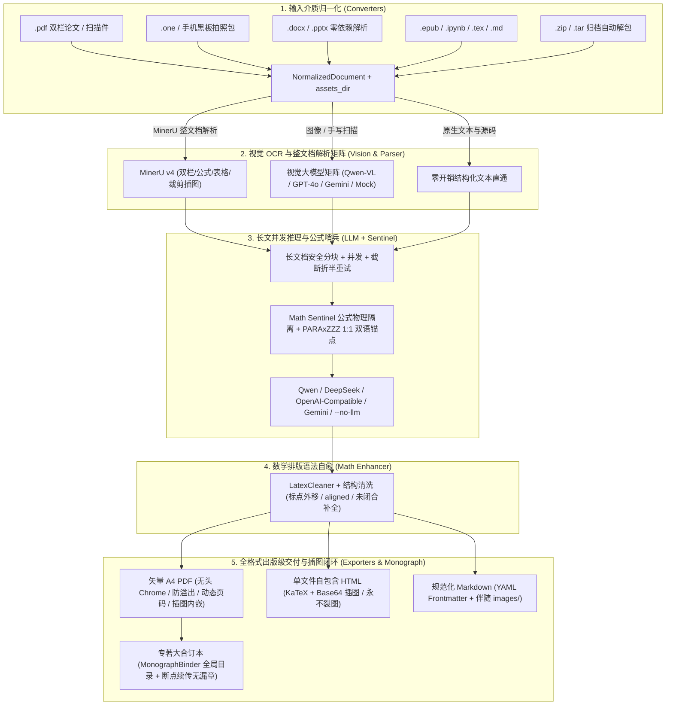

# academic_core 2.1: 解耦型通用学术文献数字化、长文精译与全格式出版引擎

`academic_core` 是一个高内聚、零强耦合、全学科通用的学术文献数字化与出版级排版框架。
无论输入是**英文双栏顶会论文 PDF、经典外文教材（PDF/EPUB）、手写黑板连拍照片、OneNote 笔记、PPT/Word 课件、Jupyter Notebook 还是 LaTeX 源码**，均可按统一六阶流水线高保真、零公式幻觉地交付为**矢量 A4 PDF、自包含独立 HTML 与规范 Markdown**。

---

## 🏗️ 核心解耦架构图



---

## 🌟 核心能力全景

1. **全介质输入归一化（9 大类格式，零强绑定）**：
   - `.pdf`（四模式：`mineru` 论文双栏留图 / `vision` 手写数学切片 / `text` 纯文本直提 / `auto`）
   - `.one`（OneNote 笔迹强制视觉高保真转绘）
   - `.docx` / `.pptx` / `.epub`（内置标准库 ZIP+XML **零依赖**解析引擎）
   - `.tex`（自动剥离导言区保留公式与章节）、`.ipynb`（Markdown+代码双单元格）、`.md` / `.txt` / `.html`
   - 手机拍照 / 黑板照片（EXIF 重力自动正立 + `--enhance-image` 粉笔/浅字迹对比度增强）
   - `.zip` / `.tar` / `.tgz` 压缩包自动解包与自然序号重排

2. **论文与长篇教材实战级翻译引擎**：
   - **长文档语义分块 + 并发推理**：按段落边界切分，绝不切断 `$$...$$` 多行公式与代码块；遇单次输出长度截断自动折半重试。
   - **Math Sentinel 物理公式哨兵**：翻译前自动将所有 `$...$` / `$$...$$` 隔离为 `MATHxZZZ`，译后逐一校验零丢失回填，杜绝公式篡改与变量误译。
   - **1:1 段落锚点精准双语 (`--bilingual`)**：通过 `PARAxZZZ` 锚点精确配对原译文，原文 100% 一字不改且省去一半输出 Token，纯公式/插图不重复冗余展示。
   - **多网关与任意目标语言**：支持 DashScope、DeepSeek、OpenAI（及任意 `--base-url` 如 OpenRouter / OneAPI / SiliconFlow / Ollama / vLLM）、Gemini、离线 Mock，支持 `--target-lang`（`zh-CN`, `en`, `ja` 等）与 `--no-llm` 纯排版直出。

3. **论文插图闭环与出版级全格式交付**：
   - **矢量 A4 PDF**：无头 Chrome + KaTeX 矢量渲染，零滚动条、超宽公式防截断、真实页码。
   - **自包含独立 HTML**：自动将论文/讲义引用的本地插图内嵌为 Base64 Data URI，单文件随处转发永不裂图。
   - **规范 Markdown**：带 YAML Frontmatter 并自动迁移伴随 `images/` 目录。
   - **断点续传与专著合订**：`.checkpoint.json` 秒级续跑，合订本自动汇总续传章节不漏章。

---

## 🚀 安装与命令行快速上手

```bash
# 安装为全局 CLI 工具
pip install -e .

# 1. 英文学术论文 PDF 精译 + 1:1 双语全格式直出 (MinerU 留图 + 公式哨兵)
academic-core -i "./paper.pdf" --task paper --pdf-mode mineru --bilingual --export all

# 2. 手写黑板照片目录 / OneNote 数字化并一键合订全书
academic-core -i "./blackboard_photos" --task note --enhance-image --merge --title "课程讲义全书"

# 3. 经典外文教材 (EPUB/PDF/DOCX) 长文精译 (DeepSeek + 专业术语强制对齐)
academic-core -i "./textbook.epub" --task textbook --provider deepseek --llm deepseek-v3 --glossary '{"manifold": "流形"}'

# 4. 接入本地 Ollama / vLLM 或自定义 OpenAI 兼容网关
academic-core -i "./notes.md" --provider openai --base-url "http://localhost:11434/v1" --llm qwen2.5

# 5. 跳过大模型，仅执行格式转换 + 公式自愈并直出出版级 PDF/HTML
academic-core -i "./draft.tex" --no-llm --export pdf,html

# 6. 零 API Key 离线快速体验 (Mock 模式)
academic-core -i "./examples/sample_linear_algebra.tex" --provider mock --ocr mock --export all
```

---

## 🐍 Python SDK 调用示例

```python
from academic_core import AcademicPipeline

pipeline = AcademicPipeline(
    llm_provider="deepseek",
    llm_model="deepseek-chat",
    vision_engine_name="mineru",   # 或 "qwen-vl-ocr" / "gpt-4o" / "mock"
    task="paper",                  # "note" | "textbook" | "paper"
    target_lang="zh-CN",
)

outputs = pipeline.process_one(
    "arxiv_paper.pdf",
    output_dir="./dist",
    export_formats=["pdf", "html", "md"],
    glossary={"attention": "注意力机制"},
    bilingual=True,
)
print(outputs)
```

---

## 🧪 自动化测试

```bash
pytest -v
```
涵盖 8 大核心模块端到端全自动验证（全离线零 Token 消耗，可在 Windows / macOS / Linux CI 直接跑通）。
